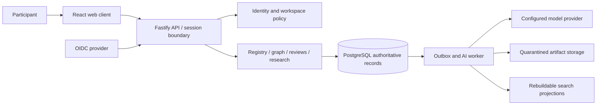
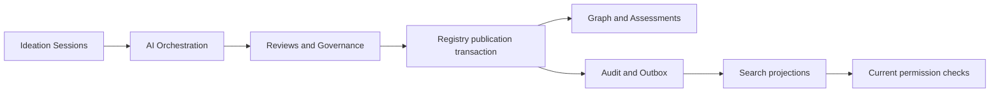

# System architecture

Status: proposed stack, not installed or implemented. Use a modular monolith:
TypeScript on Node 24 LTS, React web UI, Fastify HTTP server, PostgreSQL 17, and
an outbox worker from the same codebase. Pin exact packages and images when the
documentation gate is approved. Use an OIDC provider rather than custom passwords.

The browser never holds provider credentials or database credentials. API modules
share a transaction boundary, not unrestricted access to one another's tables.
Identity establishes actor and membership context; registry owns revision writes;
graph owns edges and assessments; research owns tasks; provenance owns audit;
workers process explicit commands with bounded service identities. Search is a
read projection and cannot become an alternative authorization source.

## Persistence alternatives

| Criterion | PostgreSQL with typed JSONB and edges | Graph database plus relational identity |
|---|---|---|
| Publication + audit atomicity | One transaction | Cross-store coordination required |
| Typed constraints / lifecycle | Relational constraints plus validators | Vendor-specific constraints and application guards |
| Multi-hop queries | Recursive CTEs with strict budgets | Strong native traversals |
| Permission review | RLS plus application checks | Traversal policy varies by engine |
| Operations and recovery | One authoritative store | Multiple recovery and consistency procedures |

Choose PostgreSQL; retain adjacency indexes and inspect plans on dense fixtures.
Consider a derived graph engine only after representative bounded traversals miss
the read SLO at agreed scale despite indexing. It must never bypass policy or
become authoritative without a separate migration decision.

## Deployment and trust

Initial topology: one API, one worker, PostgreSQL and object storage in one region
behind TLS ingress. Development can substitute a local OIDC test provider and
local S3-compatible storage; production cannot use development identities. First
slice needs API, UI, PostgreSQL, identity and an outbox worker. No Redis, vector database or
Kubernetes prerequisite. Use PostgreSQL full-text search before adding embeddings.

Browser input, imported content, artifacts and model outputs cross untrusted
boundaries. Validate schema at ingress and enforce access again in transactions.
Workers reauthorize both queued inputs and proposed outputs. Outbox delivery is
at least once; consumers deduplicate by event ID. Models never receive raw session
tokens. External notifications are opt-in and exclude restricted content.

## Component boundaries and delivery sequence

Ideation Sessions owns immutable conversation turns, attachment references and undo
pointers; AI Orchestration reads an explicitly authorized session snapshot.
Reviews owns submission grants and decisions; Registry owns publication, including
atomic multi-object publication. Search owns lexical/vector indexes and ranking,
while Identity owns current permission checks. Notifications consumes the outbox
with per-recipient authorization and no message-body content in external channels.

Hybrid lexical/graph/vector retrieval is required for the target workflow (§7).
Start with lexical retrieval in slice 4, add a versioned PostgreSQL vector projection
before slice 5 exits, and evaluate ranking against the baseline. A failed vector
quality gate is outstanding work, not permission to silently drop the requirement.
Permissioned cross-workspace discovery is an application feature within this
installation; external peer federation is a separate transport decision.
