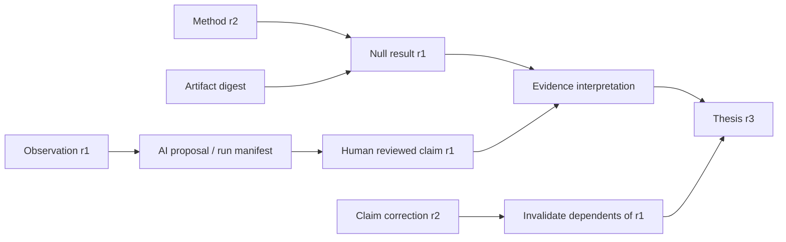

# Provenance and epistemics

Status: proposed. Provenance establishes what happened, not whether a claim is true.

Each revision records actor, origin (human/import/machine), timestamp, original
input references, transformation/run ID, schema version and reason for change.
Imports retain source URI, acquisition time, license and digest where bytes exist.
Do not fetch arbitrary URLs from the API server. Artifact ingestion uses a guarded
worker and quarantined storage. Citation verification is a separate recorded
assessment: an unverified citation cannot be displayed as verified evidence.

The arrow here means information flow; persisted `derived_from` edges point from
output to input. Human acceptance adds a disposition; explicit publication creates a published revision while
preserving the machine origin and exact input manifest. Prompt/model versions,
tool calls, validation results and costs are recorded without sensitive prompt
text in general logs. Restricted provenance stays restricted in exports and views.

## Separate epistemic dimensions

| Dimension | Examples | Must not imply |
|---|---|---|
| Lifecycle | draft, published, retracted | Truth |
| Review | unreviewed, accepted, disputed | Universal consensus |
| Polarity | supports, contradicts, qualifies, inconclusive | Strength |
| Uncertainty | qualitative rationale, calibrated interval | Probability without method |
| Freshness | current, stale, unknown | Falsehood |
| Source quality | verified acquisition, contested method | Automatic claim acceptance |

Display reviewer identity, scope, method and conflicts next to interpretations.
Maintain parallel assessments when reviewers disagree. Null results and failed
replications remain searchable with their protocols. Assessments explicitly state
which proposition and population they bear on; negative results do not automatically
falsify a broader claim.

Correlated evidence carries source-group IDs and shared dataset/method references.
The MVP displays dependency warnings and does not calculate a single confidence
score. Later synthesis must explain correlation handling, contradictory results
and omitted inputs. AI summaries cannot serve as independent corroboration of
their own sources. Staleness propagation follows revision lineage and preserves
past conclusions as historical, visibly qualified interpretations.

On source access revocation, hide source content immediately, evict derived caches,
cancel queued external-model jobs and flag existing syntheses for policy review.
Do not claim that already sent external inputs can be recalled. Provider retention
contracts and user consent are prerequisites to external AI processing.

## Audience inheritance and stale information

Derived content inherits the intersection of its input use permissions by default.
A wider audience needs explicit authorized release of all required inputs or a
separately reviewed redacted derivative with its own permitted provenance. On
revocation, policy epoch checks deny access to affected derived content before
asynchronous cache eviction finishes; review is not a substitute for immediate
read enforcement. Correlation metadata is itself permission-filtered.

Accepted assessments require inspectable source provenance for their intended
review audience. If provenance becomes unavailable, preserve the historical
acceptance event but mark the current assessment restricted/unknown and block new
acceptance until revalidated. Published validity and review history remain distinct.
