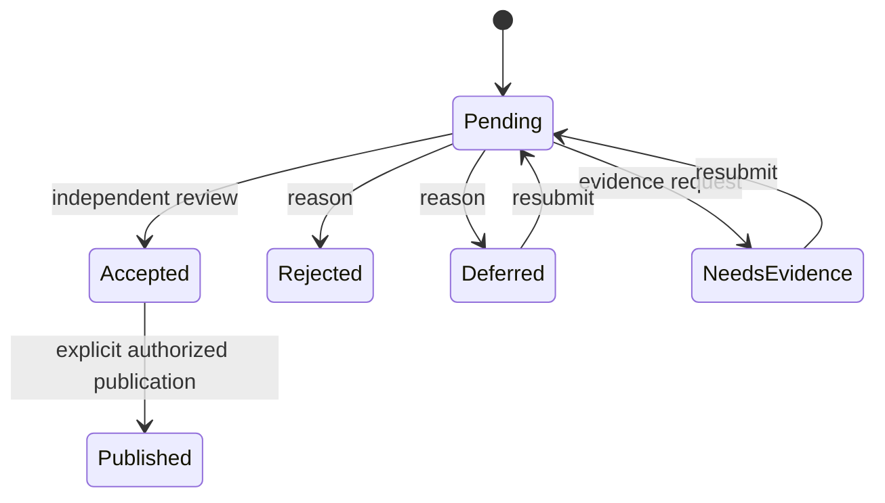

# API contracts

Status: proposed HTTP v1 contract. All routes require a secure authenticated
session, workspace membership and action authorization; object access is checked
again inside transactions. JSON bodies reject unknown fields. Max JSON body 128 KiB.

## Shared protocol

Prefix `/v1/workspaces/{workspace_id}`. Mutations require Idempotency-Key (UUID)
and CSRF token; changes to existing resources also require If-Match with the
returned opaque ETag. Store request hash and response for 24 hours, scoped to
actor/workspace/route. Same key and body returns original status/body; different
body is 409. Reauthorize before replaying a stored response. Check authorized replay before If-Match, so a retry
with its original ETag returns the committed response. Expired keys receive
ordinary concurrency protection but no promise of response replay.

Errors: `{error:{code,message,request_id,fields?}}`; no stack traces or inaccessible
IDs. 400 malformed input, 401 missing/expired session, 403 known workspace action
denied, 404 absent or inaccessible object, 409 invalid state/idempotency conflict,
412 ETag mismatch, 422 schema/reference validation, 428 missing precondition,
429 rate limit, 503 temporary dependency/budget exhaustion. Error field details
must not disclose inaccessible references. Response includes request ID and ETag.

Lists use opaque policy-scoped keyset cursors, default 25/max 100; no global total.
Invalid or policy-stale cursor requires a fresh query. Initial limits per user:
120 reads/minute, 30 writes/minute, 5 graph requests/minute, 3 AI jobs/minute plus
workspace token/currency budget. Return Retry-After on 429. Tune against workload.

| Operation | Method / route | Payload → response | Guard / audit |
|---|---|---|---|
| create_draft | POST /objects | `{type,schema_version,content}` → 201 `{id,revision,lifecycle,etag}` | Member; human cannot forge machine provenance; object.drafted |
| revise_draft | PATCH /objects/{id}/draft | `{content,reason}` → 200 revision | Author + ETag; object.revised |
| read | GET /objects/{id} | → object with provenance/freshness links | Draft owner or published reader |
| history | GET /objects/{id}/revisions | → permitted revision page | No discarded private drafts leaked |
| publish_atom | POST /objects/{id}/publish | `{revision,confirmation:true}` → published revision | Author, validated refs, ETag; object.published |
| correct_atom | POST /objects/{id}/corrections | `{base_revision,content,reason}` → private correction draft | Authorized author/reviewer; object.correction_drafted |
| link_atoms | POST /edges | `{type,from:{id,revision},to:{id,revision},rationale}` → 201 edge | Typed endpoints, graph guards; edge.created |
| assess_evidence | POST /assessments | `{claim_ref,evidence_ref,method_ref,polarity,scope,uncertainty,rationale}` → 201 assessment | Assessor identity, pinned refs; assessment.created |
| create_task | POST /tasks | `{title,criteria,method_ref,dependency_refs}` → 201 task | Member, no cycles; task.created |
| assign_task | POST /tasks/{id}/assignment | `{assignee_id,consent_ref}` → pending/accepted assignment | Coordinator, explicit assignee acceptance; task.assignment_changed |
| submit_result | POST /tasks/{id}/results | `{outcome,method_ref,context,artifact_refs}` → 201 result | Assignee or coordinator; result.submitted |
| register_artifact | POST /artifacts | `{filename,media_type,byte_size,sha256,license}` → quarantine upload instruction | Size/type policy; artifact.registered; not downloadable until scan |
| query_graph | POST /graph/query | `{root_ids,edge_types,depth,cursor?}` → `{nodes,edges,truncated,next_cursor}` | Every hop authorized, budgets; graph.queried metadata |
| retrieve_provenance | GET /objects/{id}/provenance | → bounded permitted lineage | Same graph budgets; provenance.read metadata |
| propose_atoms | POST /ai/intake | `{input_refs,instruction,budget}` → 202 `{job_id}` | Explicit provider consent; ai.queued |
| request_synthesis | POST /ai/synthesis | `{input_refs,question,budget}` → 202 job | Scoped retrieval, budget reservation; ai.queued |
| review_proposal | POST /proposals/{id}/dispositions | `{decision,reason,expected_revision}` → disposition | Human reviewer, no self-accept; proposal.disposed |
| job status/cancel | GET /jobs/{id}; POST /jobs/{id}/cancel | → run state; cancellation receipt | Requester or authorized operator; job.cancelled |
| export | POST /exports | `{object_ids,format:"json-v1"}` → 202 job | Reauthorize at generation/download; export.requested |

First slice implements only drafts, revisions, read/history, publication, projects
and project references. Project routes: POST /projects `{name}`, POST
/projects/{id}/objects `{object_id}`, DELETE /projects/{id}/objects/{object_id},
DELETE /projects/{id}. All mutations use shared preconditions and audit names
project.created/object_linked/object_unlinked/deleted. Delete never cascades atoms.

Example creation body:
`{"type":"claim","schema_version":1,"content":{"title":"Cooling trial","body":"Protocol A reduces peak temperature under conditions C","language":"en","source_refs":[],"proposition":"Lower peak temperature","scope":"Bench apparatus C","qualifiers":["Unverified"]}}`.
Creation produces a private draft, never an accepted claim.

## Transaction and publication sequence

```mermaid
sequenceDiagram
  participant U as Human
  participant A as API
  participant D as PostgreSQL
  participant W as Worker
  U->>A: Publish(revision, If-Match, key)
  A->>D: BEGIN; set actor; authorize; lock object
  A->>D: Check key/hash, revision, state and references
  A->>D: Append published revision, audit, outbox, replay response
  A->>D: COMMIT
  A-->>U: 200 + ETag
  W->>D: Claim outbox event
  W->>D: Idempotent projection update / invalidation
```

## Common payload and concurrency rules

Reference = `{id: UUID, revision: positive integer}`; identifiers and identity claims
come from the server/session. Human routes cannot set origin/run/actor fields;
imports and AI use authenticated internal commands. Require nonempty reasons
(maximum 4,000 characters), decision enums and type-specific fields in the data
model. Revision arrays have at most 100 elements. Body size limits override field
limits. A write exceeding those limits returns 413 before transaction work.

If-Match refers to the target object's row_version, project version or job version;
creation has no precondition. Child mutations use the parent ETag. Reference
revisions are immutable but their current permissions are rechecked. Graph queries
are read operations despite POST and do not require idempotency or If-Match.
Idempotency scope includes HTTP method and normalized resource path, so IDs in two
paths cannot collide. Persist replayable successful responses atomically; denied
requests do not reserve keys. Concurrent identical keys serialize on the unique
constraint; transient rollbacks may retry within a bounded deadline.

## Missing workflow operations

All mutations below inherit session/CSRF, permissions, idempotency, ETag, limits and
errors above. Lists inherit pagination. Transitions return `{id,revision,status,etag}`.

| Operation / route | Body and response | Guard and event |
|---|---|---|
| POST /objects/{id}/submissions | `{revision,reviewer_ids,purpose}` → submission | Author; grant only selected revision/inputs; review.submitted |
| POST /submissions/{id}/decisions | `{decision,reason}` → immutable review | Named independent reviewer; review.decided |
| POST /objects/{id}/transitions | `{axis,to_state,revision,reason,replacement_ref?}` → status | Transition table below; object.transitioned |
| POST /publications | `{object_refs,edge_refs,audience,confirmation:true}` → published IDs/revisions | Human; max 100 items, all refs validated and locked in sorted-ID order; graph.published |
| POST /equivalences | `{left_ref,right_ref,rationale}` → candidate | Both refs readable; equivalence.proposed |
| POST /equivalences/{id}/decisions | `{decision,reason}` → reviewed/rejected/revoked | Independent reviewer; equivalence.disposed |
| POST /sessions; POST /sessions/{id}/turns | `{title}`; `{text,attachment_refs,parent_turn}` → session/turn | Author, permitted clean attachments; session.created/turn.recorded |
| POST /sessions/{id}/undo | `{target_turn,reason}` → active turn pointer | Author; immutable turns retained; session.undo_recorded |
| POST /ai/formalise | `{session_ref,input_refs,budget}` → 202 job | Session access, provider consent; ai.queued |
| POST /capabilities; POST /tasks/{id}/matches | typed capability; `{constraints}` → capability / ranked candidates | Provider identity for creation, coordinator for match; capability.created/match.requested |
| POST /tasks/{id}/assignment/decisions | `{decision:accept/decline,reason}` → assignment | Proposed assignee; consent cannot be asserted by coordinator; assignment.decided |
| POST /objects/{id}/grants | `{revision,target_workspace_id,allowed_uses,expires_at}` → grant | Owner release permission, source rights; grant.created |
| DELETE /grants/{id} | no body → 204 | Grant owner/release administrator; grant.revoked + policy epoch increment |
| GET /search | `q,channels,cursor` → ranked permitted refs | Lexical/graph/vector scoped before ranking and response |

Atomic publication locks and revalidates every candidate, audience, input and
proposal disposition; failures roll back objects, edges, lineage, audit and outbox.
Accepted proposals retain temporary candidate IDs until this transaction maps them
to durable IDs. Acceptance alone publishes nothing. Publication is limited to
already-reviewed exact revisions for machine-origin content. A fresh edit revokes
that acceptance for the edited revision.

## State machines and guards

Unlisted transitions are 409. Every transition requires an authorized current ETag,
valid schema, permitted input refs, append-only event and transactional audit/outbox.
Review and distribution are orthogonal: dispute does not retract; acceptance does
not publish. The event column is the specific audit action for the shared route.

| Entity/axis | From → to | Actor and additional guard | Event |
|---|---|---|---|
| Claim/synthesis review | unreviewed → submitted | Author, named reviewers, exact revision grants | review.submitted |
| Claim/synthesis review | submitted → accepted/rejected/needs_evidence | Independent assigned reviewer, conflict declaration and inspectable provenance | review.decided |
| Claim/synthesis review | needs_evidence/rejected → submitted | Author supplies revised submission; prior decision retained | review.resubmitted |
| Claim/synthesis review | accepted → disputed | Authorized reviewer, challenge rationale | review.disputed |
| Claim/synthesis review | disputed → accepted/rejected | Different reviewer adjudicates challenge with reason | review.adjudicated |
| Claim/synthesis distribution | draft → published | Author confirms audience; AI requires accepted exact revision; refs audience-compatible | object.published |
| Claim/synthesis validity | active → retracted/superseded | Author withdrawal or moderator; superseded requires accessible replacement and cycle check | object.retracted/object.superseded |
| Review record | recorded → superseded | New independent review references old decision; never UPDATE old content | review.superseded |
| Proposal disposition | pending → accepted/rejected/deferred/needs_evidence | Independent assigned human; exact manifest and budget completed; no publication | proposal.disposed |
| Proposal disposition | deferred/needs_evidence → pending | Requester resubmits with reason/new inputs; revoke stale grants | proposal.resubmitted |
| Task | draft → open | Coordinator; criteria/method and dependencies valid | task.opened |
| Task | open → assigned | Named assignee accepts current invitation | task.assigned |
| Task | assigned → in_progress | Assignee; prerequisites complete | task.started |
| Task | in_progress/returned_for_revision → submitted | Assignee; result refs and acceptance evidence supplied | task.submitted |
| Task | submitted → completed/returned_for_revision | Independent reviewer evaluates criteria | task.reviewed |
| Task | any nonterminal → cancelled | Creator/coordinator; reason; notify assignee | task.cancelled |
| Result | draft → submitted | Assignee/coordinator; method/context/artifacts validated | result.submitted |
| Result | submitted → reviewed | Independent reviewer; assessment decision recorded | result.reviewed |
| Result | reviewed → disputed/retracted | Reviewer challenges / author or moderator withdraws | result.disputed/result.retracted |
| Artifact | quarantined → scanning → available/rejected | Ingestion service; digest, type, size, malware verdict | artifact.scan_started/artifact.scan_completed |
| Artifact | available → restricted/retracted | Moderator or owner; reason; revoke download grants | artifact.restricted/artifact.retracted |



The diagram shows proposal review followed by a separate publication action; it
is not the AI run state machine. Queued/running/validating cancellation terminates
execution; completed proposals can be withdrawn through disposition controls.

## First-slice bootstrap and browse contracts

OIDC entry/callback/logout live outside the workspace prefix. Login validates
issuer, audience, signature, state, nonce and PKCE; rotate session ID after login.
GET /v1/session returns user identity, allowed workspaces and a CSRF token, never
OIDC tokens. Logout invalidates the server session and expires its cookie.
POST /v1/workspaces `{name}` creates a workspace and creator member/admin roles
atomically for an authenticated user; workspace creation has a five-per-day
initial limit. Production enrollment may restrict eligible identities by configured
issuer/organization policy. This is an application policy, not email-domain trust.

Within a workspace, GET /objects and GET /projects provide authorized keyset pages;
GET /projects/{id}/objects returns only permitted references. POST /memberships
`{user_id,roles}` and DELETE /memberships/{user_id} require admin, current workspace
ETag, idempotency and configured MFA. Subjects must already be registered identities;
no invitation email is sent implicitly. Audit membership.granted/revoked, bump the
policy version and invalidate sessions' cached workspace authorization. Prevent
removing the final administrator. All object/project APIs enforce membership even
when an active login session survives workspace revocation.

## Implemented research contracts

The concrete slice 3 routes, ETag scopes, upload limits and explicit result
publication boundary are recorded in [the implementation contract](19_RESEARCH_ARTIFACT_IMPLEMENTATION.md).

## Implemented retrieval and export contracts

See [slice 4](20_RETRIEVAL_EXPORT_IMPLEMENTATION.md) for bounded lexical/graph
retrieval, opaque cursors, revision export permissions and job/download reauthorization.
